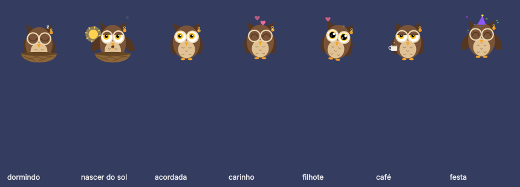

# 🦉 Coruja para Linux

Um amiguinho de mesa que mantém o computador acordado.



- **Olhos abertos**: a tela não apaga e o computador não suspende.
- **Olhos fechados**: tudo volta ao normal.

Ela é pequena, fica num cantinho da tela e tem vida própria: respira, pisca, olha para o
mouse, passeia, toma café, almoça e dorme no ninho.

> Também existe para [macOS](https://github.com/RafaelRJesus/MAC_Coruja) e [Windows](https://github.com/RafaelRJesus/Windows_Coruja).

## Instalação

```bash
git clone https://github.com/RafaelRJesus/Linux_Coruja.git
cd Linux_Coruja
bash instalar.sh               # ou: bash instalar.sh --autostart (abre junto com o computador)
```

Depois é só abrir a **Coruja** pelo menu de aplicativos ou rodar `coruja` no terminal.

Precisa do **Python 3.10+** com `venv`. O Qt também precisa da biblioteca `libxcb-cursor`;
o instalador avisa se faltar:

| Distro | Comando |
|---|---|
| Ubuntu / Debian / Mint | `sudo apt install python3-venv libxcb-cursor0` |
| Fedora | `sudo dnf install xcb-util-cursor` |
| Arch / Manjaro | `sudo pacman -S xcb-util-cursor` |

Opcional: com o `xdotool` instalado, a coruja também evita que apps de chat marquem você como ausente.

Para remover: `bash desinstalar.sh`.

## Como usar

| Ação | O que acontece |
|---|---|
| Clicar nos **olhos** | Acorda / põe a coruja para dormir |
| Clicar na **orelha direita** (a do brinco) | Quando dormir: temporizador ou horário |
| Clicar na **orelha esquerda** | Animações: liga/desliga, opções e tamanho |
| Clicar na **barriga** | Carinho (olhinhos ^^ e corações) |
| Arrastar a coruja | Move pela tela (ela bate as asas) |
| Botão direito ou ícone na bandeja | Menu com tudo isso e "Sair" |

### Quando dormir (orelha direita)

- **Sem limite**: fica acordada até você fechar os olhos dela.
- **Temporizador**: contagem regressiva e depois dorme sozinha.
- **Horário**: dorme num horário fixo (se já passou hoje, vale para amanhã).

A pedra do brinco mostra a opção ativa: **laranja** = sem limite, **azul** = temporizador,
**verde** = horário.

### Animações (orelha esquerda)

- **Sempre**: espreguiça com o nascer do sol ao acordar, se aninha no ninho com o pôr do sol
  ao dormir, bate as asas quando arrastada e fica feliz com carinho.
- **Aleatórias** (sorteadas, sem repetir a anterior): olhar em volta, piar, bater asas,
  pulinho, descansar no ninho, bocejar e passear pela tela.
- **Chamar atenção** (opcional): carinha de filhote de vez em quando.
- **Por horário** (opcional, uma vez por dia num momento sorteado): café (8:30–10h),
  almoço (12–13:30), lanche (15:30–16:30), festa na sexta (17–18h), anoitecer (18:30)
  e amanhecer (6h).

### Leve

Parada, usa de 8 a 12 quadros por segundo; 30 só durante uma animação. Com as animações
desligadas, fica parada e não usa processamento.

## Como ela mantém o computador acordado

Cada ambiente gráfico faz isso de um jeito, então a coruja tenta todos e ignora o que não existir:

- `org.freedesktop.ScreenSaver.Inhibit` (KDE, XFCE, Cinnamon, MATE, LXQt…)
- `org.gnome.SessionManager.Inhibit` (GNOME)
- `systemd-inhibit` (bloqueia suspensão e ociosidade)
- A cada 4 minutos avisa que há atividade (`SimulateUserActivity` e, no X11, a tecla F15 via `xdotool`)

No **Wayland**, as janelas não podem se posicionar sozinhas. Se o XWayland estiver disponível,
a coruja usa ele para conseguir passear e lembrar onde você a deixou.

## Estrutura

```
coruja/
  settings.py   configurações (~/.config/coruja/settings.json)
  owl.py        desenho da coruja a partir de uma Pose
  effects.py    partículas, sol, ninho e objetos
  animator.py   motor de animação (não desenha nada)
  keepawake.py  mantém o computador acordado
  view.py       janela transparente e cliques
  panels.py     painéis das orelhas
  app.py        liga tudo
```

Feito com Python e [PySide6](https://doc.qt.io/qtforpython-6/) (Qt).
